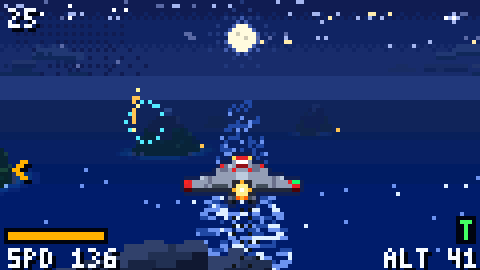
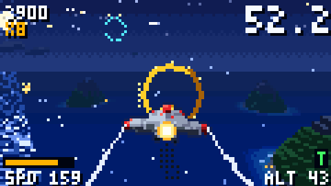
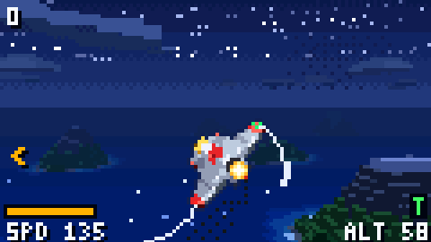
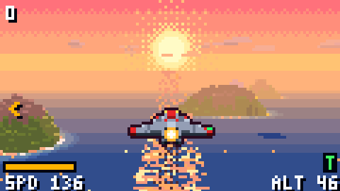
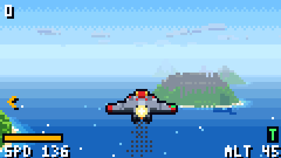
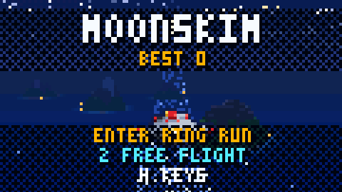

# MOONSKIM — pixel fighter jet for the Cardputer-Adv

**English** | [简体中文](README.zh-CN.md)

A pixel-art fighter-jet flyer for the **M5Stack Cardputer-Adv**: a starry night sky, a moonlit ocean, voxel islands and clouds, and an original voxel jet called "Kestrel". **Tilt the device (BMI270 IMU) to fly.** Roll, boost, and thread rings for points. It runs at a locked 60 fps on the device.

Inspired by a sprite-stacking web demo. All code and art here (the jet's voxel model, the palettes and so on) are original.

| Night | Ring Run | Banking |
|---|---|---|
|  |  |  |
| **Sunset** | **Day** | **Title** |
|  |  |  |

## Gameplay

- **Ring Run** (Enter): a 45 s countdown. Each ring you fly through adds time and score, and consecutive rings build a combo (up to ×8). Skimming the sea, rolling or boosting through a ring earns bonuses. The best score is saved in NVS.
- **Free Flight** (2): fly freely with no timer.
- Hitting an island, or hitting the sea too fast, crashes the jet. You respawn quickly and carry on.

## Controls (device)

Hold the Cardputer in landscape. While **HOLD STILL** is shown at the start, keep it steady: that pose becomes neutral.

| Action | Input |
|---|---|
| Turn | Tilt the device left/right (or `,` `/`, `A` `D`) |
| Dive / climb | Tip the top edge away / toward you (or `.` `;`, `S` `W`) |
| Boost | `Space` / `Alt` |
| Barrel roll | `Z` / `X` (or `L` / `'`) |
| Start / confirm | `Enter`; `2` for Free Flight |
| Pause | `P` / `` ` `` / G0 button |
| Recalibrate tilt | `C` |
| Tilt on/off / invert pitch | `T` / `I` |
| Time of day / camera | `N` / `V` |
| FPS stats / help | `F` / `H` |
| Mute / volume / brightness | `M` / `-` `=` / `[` `]` |

## Build and flash

Requires [PlatformIO](https://platformio.org/).

```powershell
pio run -e cardputer-adv -t upload           # build and flash
pio device monitor -e cardputer-adv          # serial log (115200)
```

Other environments: `cardputer-adv-bench` (no frame cap, runs a benchmark at boot), `cardputer-adv-debug` (IMU data stream), `cardputer-adv-spi80` (80 MHz SPI overclock).

Single-character serial commands: `?` help, `b` 20 s autopilot benchmark, `g` screenshot (with `python tools/grab_shot.py COM3 out.png`), `i` IMU stream, `r`/`p` flip roll/pitch direction, `h` memory, `v` reprint the boot log.

## Preview on a PC

The core (`src/core`) is platform-independent C++17 and runs directly on Windows (requires Visual Studio 2022 Build Tools):

```powershell
tools\play\build.bat                          # interactive window: mouse = tilt, keys as on the device
tools\play\out\moonskim_pc.exe

tools\sim\build.bat wx test                   # scripted simulator: 22 scenarios, screenshots, determinism check
```

## Technical notes

- A 120×68 palette-indexed frame plus a depth buffer, scaled 2× to 240×135. A present task on core 0 pushes frames to the display over DMA, fully overlapped with rendering on core 1.
- A front-to-back voxel terrain march (Comanche-style) draws the sea, islands and clouds in a single pass. World generation is integer-only, so the PC and the device produce the same world CRC.
- The voxel jet: 914 shell voxels, back-face culling, perspective without divides, 26-normal lighting, outline, afterburner flame and shadow.
- Gyro-fused tilt control: automatic calibration, soft deadzone, response curve, and compensation for drift of the neutral pose.
- 16 kHz software-synthesised sound.
- Measured on the device (20 s benchmark): fps_min 59.8 / avg 60.0, about 8 ms of core-1 work per frame.

The full design is in [docs/DESIGN.md](docs/DESIGN.md).
