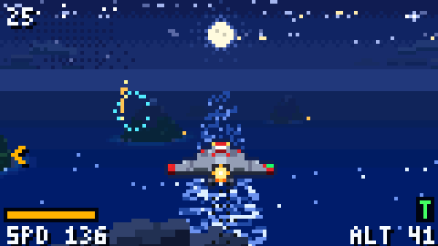
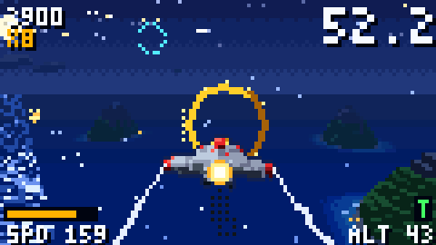
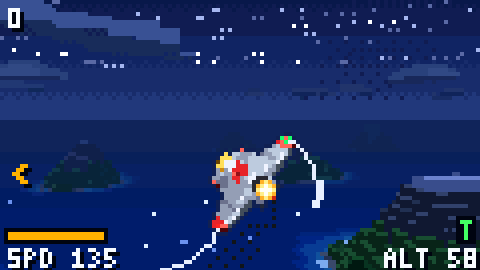
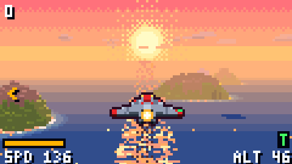

# MOONSKIM — Cardputer-Adv 像素战机

[English](README.md) | **简体中文**

一个跑在 **M5Stack Cardputer-Adv** 上的像素风战机飞行小游戏：夜空星海、月光海面、体素岛屿与云层，原创体素战机 "Kestrel"，**倾斜机身（BMI270 IMU）即可操控**，可翻滚、加速、穿环计分。设备上稳定 60 fps。

灵感来自一个 sprite stacking 网页 demo；本项目的代码与美术（战机体素模型、调色板等）均为原创实现。

| 夜晚 | 穿环 | 压坡度 |
|---|---|---|
|  |  |  |
| **黄昏** | **白天** | **标题** |
|  |  |  |

## 玩法

- **Ring Run**（Enter）：45 秒倒计时，穿过前方的环加时、加分，连续穿环叠连击（最高 ×8），贴海低飞、翻滚、加速穿环有额外奖励。最高分存进 NVS。
- **Free Flight**（2）：自由飞行，不计时。
- 撞岛或高速扎海会坠毁，迅速复活继续。

## 操控（设备）

横握 Cardputer，开局出现 **HOLD STILL** 时保持平稳——此时的姿势就是"中立位"。

| 操作 | 方式 |
|---|---|
| 转弯 | 左右倾斜机身（或 `,` `/`、`A` `D`） |
| 俯冲 / 爬升 | 上沿往外压 / 往回拉（或 `.` `;`、`S` `W`） |
| 加速 | `Space` / `Alt` |
| 桶滚 | `Z` / `X`（或 `L` / `'`） |
| 开始 / 确认 | `Enter`；`2` 自由飞行 |
| 暂停 | `P` / `` ` `` / G0 键 |
| 重新校准倾斜 | `C` |
| 倾斜开关 / 俯仰反转 | `T` / `I` |
| 昼夜切换 / 视角 | `N` / `V` |
| 帧率统计 / 帮助 | `F` / `H` |
| 静音 / 音量 / 亮度 | `M` / `-` `=` / `[` `]` |

## 构建与烧录

需要 [PlatformIO](https://platformio.org/)。

```powershell
pio run -e cardputer-adv -t upload           # 编译并烧录
pio device monitor -e cardputer-adv          # 串口日志（115200）
```

其他环境：`cardputer-adv-bench`（不锁帧 + 开机自动跑分）、`cardputer-adv-debug`（IMU 数据流）、`cardputer-adv-spi80`（80 MHz SPI 超频）。

串口单字符命令：`?` 帮助、`b` 20 秒自动驾驶跑分、`g` 截图（配合 `python tools/grab_shot.py COM3 out.png`）、`i` IMU 数据流、`r`/`p` 翻转横滚/俯仰方向、`h` 内存、`v` 重打启动日志。

## 在电脑上预览

核心代码（`src/core`）是与平台无关的 C++17，可以在 Windows 上直接跑（需要 Visual Studio 2022 Build Tools）：

```powershell
tools\play\build.bat                          # 可交互窗口版：鼠标模拟倾斜，键盘同设备
tools\play\out\moonskim_pc.exe

tools\sim\build.bat wx test                   # 脚本化模拟器：22 个场景、截图、确定性校验
```

## 技术要点

- 120×68 调色板索引帧 + 深度缓冲，2× 放大到 240×135；core 0 上的推屏任务用 DMA 异步推屏，与 core 1 的渲染完全重叠。
- Comanche 式前后向体素地形 march，海面、岛屿、云层一次画完；整数化世界生成（PC 与设备 CRC 一致）。
- 体素战机：914 个外壳体素，背面剔除、无除法透视、26 法线光照、描边、尾焰、影子。
- 陀螺仪融合的倾斜控制：自动校准、软死区、响应曲线、中立位漂移补偿。
- 16 kHz 软件合成音效。
- 设备实测（20 s 跑分）：fps_min 59.8 / avg 60.0，core-1 每帧约 8 ms。

详细设计见 [docs/DESIGN.md](docs/DESIGN.md)。
